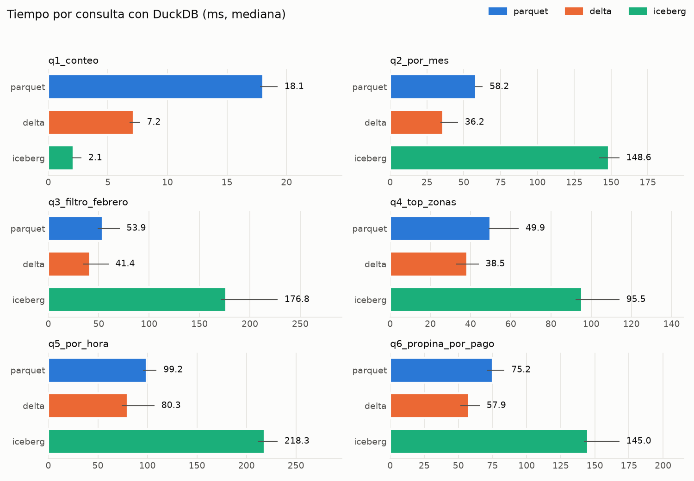
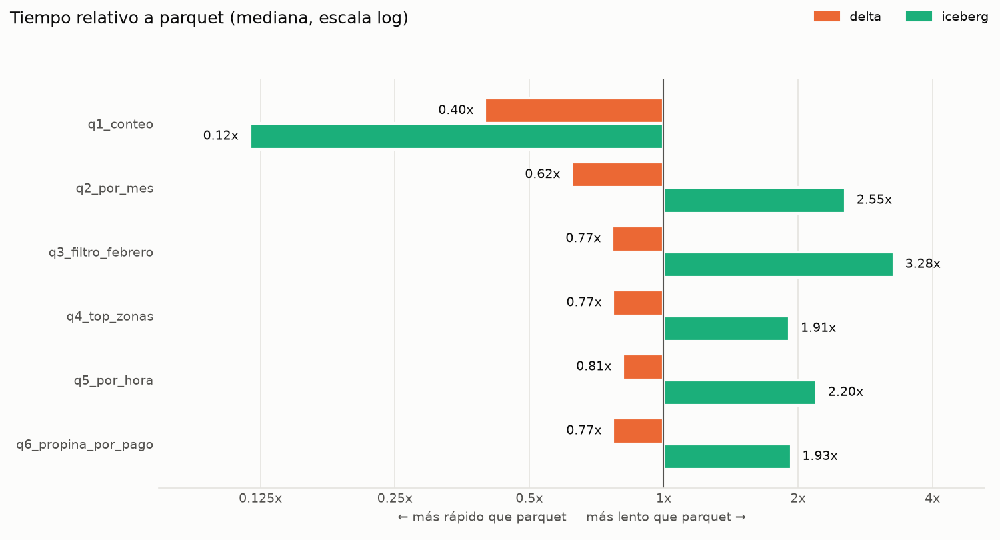

# Lakehouse Lab: Delta Lake vs Apache Iceberg

Laboratorio práctico para explorar y medir las diferencias entre **Delta Lake** y **Apache Iceberg**, los dos formatos de tabla abiertos más usados en arquitecturas *lakehouse*. Con PySpark y los datos públicos de viajes de taxi de Nueva York (NYC TLC), el proyecto construye las mismas tablas en ambos formatos y compara su comportamiento en ingesta, consultas, actualizaciones, evolución de esquema, *time travel* y mantenimiento. El objetivo es obtener métricas reproducibles que sirvan para decidir qué formato conviene en cada caso.

## Tabla de contenido

- [Descripción](#descripción)
  - [Motivación](#motivación)
  - [Datos](#datos)
  - [Qué se compara](#qué-se-compara)
  - [Stack tecnológico](#stack-tecnológico)
- [Estructura](#estructura)
- [Uso](#uso)
  - [Comandos de ingesta](#comandos-de-ingesta)
  - [Benchmark de compresión](#benchmark-de-compresión)
- [Week 1](#week-1)
  - [Qué se construyó](#qué-se-construyó)
  - [OPTIMIZE: compactación de archivos](#optimize-compactación-de-archivos)
  - [VACUUM: limpieza de archivos retirados](#vacuum-limpieza-de-archivos-retirados)
  - [Aprendizajes](#aprendizajes)
  - [Problemas y soluciones](#problemas-y-soluciones)
- [Week 2](#week-2)
  - [Resumen de la semana 2](#resumen-de-la-semana-2)
  - [Catálogo y tabla Iceberg](#catálogo-y-tabla-iceberg)
  - [Snapshots](#snapshots)
  - [Hidden partitioning](#hidden-partitioning)
  - [Evolución de partición](#evolución-de-partición)
  - [Rollback](#rollback)
  - [Problemas y soluciones de Iceberg](#problemas-y-soluciones-de-iceberg)
  - [Spark con Delta e Iceberg](#spark-con-delta-e-iceberg)
  - [Actualizar un mes completo con Spark](#actualizar-un-mes-completo-con-spark)
  - [Versiones finales](#versiones-finales)
  - [Problemas de compatibilidad de versiones](#problemas-de-compatibilidad-de-versiones)
  - [Cómo ejecutar los jobs y las pruebas](#cómo-ejecutar-los-jobs-y-las-pruebas)
  - [Decisiones y siguientes pasos](#decisiones-y-siguientes-pasos)
- [Week 3](#week-3)
  - [Benchmark de consultas con DuckDB](#benchmark-de-consultas-con-duckdb)
  - [Resultados](#resultados)
  - [Por qué Iceberg sale más lento](#por-qué-iceberg-sale-más-lento)
  - [Problemas y soluciones del benchmark](#problemas-y-soluciones-del-benchmark)
  - [Dashboard de benchmarks](#dashboard-de-benchmarks)

## Descripción

### Motivación

Delta Lake y Apache Iceberg resuelven el mismo problema: añadir transacciones ACID, control de versiones y gestión de metadatos sobre archivos Parquet en un *data lake*. Sin embargo, difieren en su diseño interno (log de transacciones frente a árbol de metadatos y *snapshots*), en cómo manejan particiones y en las operaciones de mantenimiento que requieren. Este proyecto busca medir esas diferencias con datos reales en lugar de quedarse en la comparación teórica.

### Datos

Se usan los registros de viajes de **taxis amarillos** publicados por la [NYC Taxi & Limousine Commission](https://www.nyc.gov/site/tlc/about/tlc-trip-record-data.page):

- `yellow_tripdata_2025-01.parquet` a `yellow_tripdata_2025-03.parquet`: viajes de enero a marzo de 2025.
- `taxi_zone_lookup.csv`: catálogo de zonas de taxi (borough, zona y zona de servicio).

Los archivos originales, tal como se descargan, se guardan en `data/landing/`. A partir de ellos, `lh-partition-date` genera en `data/raw/` un dataset unificado y particionado por fecha de recogida (`year=.../month=...`). Ninguno de los dos directorios se versiona en el repositorio.

### Qué se compara

Cada experimento se ejecuta sobre las mismas tablas escritas en ambos formatos:

| Dimensión | Qué se mide |
|---|---|
| Ingesta | Tiempo de escritura inicial y cargas incrementales por mes |
| Consultas | Latencia de consultas analíticas, *partition pruning* y *data skipping* |
| Operaciones DML | `UPDATE`, `DELETE` y `MERGE` (upserts) |
| Evolución de esquema | Agregar, renombrar y cambiar tipos de columnas |
| Particionamiento | Particionamiento explícito frente a *hidden partitioning* |
| *Time travel* | Consulta de versiones o *snapshots* anteriores |
| Mantenimiento | Compactación de archivos pequeños, `VACUUM` y expiración de *snapshots* |
| Almacenamiento | Tamaño en disco, número de archivos y volumen de metadatos |

### Stack tecnológico

- **Python** 3.11+
- **PySpark** 4.1 como motor de procesamiento, con `delta-spark` y el runtime de Iceberg
- **PyArrow** para lectura y escritura de Parquet
- **DuckDB** 2.0 para consultar Parquet, Delta e Iceberg en los benchmarks, y **matplotlib** para las gráficas
- **Delta Lake** y **Apache Iceberg** como formatos de tabla
- **Poetry** para la gestión de dependencias
- **pytest** para las pruebas

## Estructura

```text
lakehouse-lab/
├── data/                     # No versionado
│   ├── landing/              # Archivos originales de NYC TLC, sin modificar
│   └── raw/                  # Dataset unificado y particionado por fecha
├── docs/                     # Documentación y resultados de los benchmarks
├── notebooks/                # Exploración y análisis interactivo
├── src/
│   └── lakehouse/
│       ├── ingest/           # Carga y limpieza de los datos crudos
│       ├── spark/            # Configuración de la sesión de Spark
│       ├── delta/            # Creación y operaciones sobre tablas Delta
│       ├── iceberg/          # Creación y operaciones sobre tablas Iceberg
│       ├── benchmarks/       # Experimentos y medición de métricas
│       ├── dashboard/        # App de Streamlit con los resultados
│       └── versions.py       # Versiones de Spark, Delta e Iceberg
├── tests/                    # Pruebas unitarias
├── Makefile                  # make install, test, test-spark, test-report
├── pyproject.toml            # Configuración del proyecto y dependencias
├── poetry.lock
└── README.md
```

## Uso

Instala las dependencias y los comandos del proyecto con:

```bash
poetry install    # o: make install
```

Spark necesita además un JDK 17 o 21 en el sistema (ver [Versiones finales](#versiones-finales)).

### Comandos de ingesta

El módulo `lakehouse.ingest` ofrece tres comandos para preparar los datos. Leen Parquet o CSV (`.csv`, `.csv.gz`, `.csv.bz2`, `.csv.lz4`, `.csv.zst`), procesan por lotes para mantener acotado el uso de memoria y comparten estas opciones:

| Opción | Descripción |
|---|---|
| `-f`, `--formato` | Formato de salida: `parquet` (por defecto) o `csv` |
| `-c`, `--compresion` | Parquet: `none`, `snappy`, `gzip`, `brotli`, `lz4`, `zstd` (por defecto). CSV: `none` (por defecto), `gzip`, `bz2`, `lz4`, `zstd` |
| `--sobrescribir` | Reemplaza el destino si ya existe |

**`lh-convert`**: convierte un archivo entre Parquet y CSV, o cambia su compresión. Con `-p` genera un dataset particionado por columnas existentes.

```bash
poetry run lh-convert data/landing/yellow_tripdata_2025-01.parquet data/interim/yellow_2025-01.csv -f csv
poetry run lh-convert data/interim/yellow_2025-01.csv data/interim/yellow_2025-01.parquet
poetry run lh-convert data/landing/yellow_tripdata_2025-01.parquet data/interim/por_vendor/ -p VendorID
```

**`lh-merge`**: une varios archivos del mismo formato y esquema en uno solo. Si el origen es un directorio particionado estilo Hive, las particiones (`year`, `month`, ...) se agregan como columnas.

```bash
poetry run lh-merge data/landing/yellow_tripdata_2025-0*.parquet data/interim/yellow_2025_q1.csv.gz -f csv -c gzip
poetry run lh-merge data/raw/yellow_tripdata.parquet data/interim/yellow_tripdata.csv -f csv
```

**`lh-partition-date`**: une varios archivos en un dataset particionado por una columna de fecha o timestamp. Cada fila se ubica según su propia fecha, sin importar el archivo del que provenga.

```bash
poetry run lh-partition-date data/landing/yellow_tripdata_2025-0*.parquet data/raw/yellow_tripdata.parquet \
    --columna tpep_pickup_datetime --granularidad month \
    --desde 2025-01-01 --hasta 2025-04-01
```

| Opción | Descripción |
|---|---|
| `--columna` | Columna de fecha o timestamp (obligatoria) |
| `--granularidad` | `year`, `month` (por defecto) o `day` |
| `--desde` / `--hasta` | Rango de fechas en formato ISO 8601; `--desde` es inclusiva y `--hasta` exclusiva |

Cada comando muestra todas sus opciones con `--help`.

### Benchmark de compresión

**`lh-bench-compression`**: convierte un archivo con cada códec usando `lh-convert` y mide el tiempo de escritura, el tamaño en disco y el tiempo de lectura. Muestra la tabla de resultados y la guarda en `docs/benchmarks/compresion_<formato>_<AAAAMMDD_HHMMSS>.md`.

```bash
poetry run lh-bench-compression data/landing/yellow_tripdata_2025-01.parquet -r 3
poetry run lh-bench-compression data/landing/yellow_tripdata_2025-01.parquet -f csv
poetry run lh-bench-compression data/landing/yellow_tripdata_2025-01.parquet -c none zstd brotli
```

| Opción | Descripción |
|---|---|
| `-f`, `--formato` | Formato de salida: `parquet` (por defecto) o `csv` |
| `-c`, `--compresiones` | Códecs a comparar. Por defecto, Parquet: `zstd gzip lz4 snappy`; CSV: `zstd gzip lz4 bz2` |
| `-r`, `--repeticiones` | Mediciones por códec; se reporta la mediana (por defecto: 1) |
| `--dir-trabajo` | Directorio de los archivos convertidos (por defecto: `data/benchmarks`) |
| `--dir-salida` | Directorio del reporte (por defecto: `docs/benchmarks`) |
| `--conservar` | Conserva los archivos convertidos, que por defecto se eliminan tras medirlos |

El tiempo de escritura incluye la lectura del origen; con un origen Parquet ese costo es bajo y parecido entre códecs. La lectura se hace justo después de escribir, así que el archivo suele estar en la caché del sistema operativo y lo que se mide es sobre todo la descompresión.

#### Con el dataset completo

El benchmark recibe un único archivo de origen, por lo que primero hay que unir el dataset particionado en un solo Parquet:

```bash
# 1. Particionar por fecha los archivos originales (si data/raw aún no existe)
poetry run lh-partition-date data/landing/yellow_tripdata_2025-0*.parquet data/raw/yellow_tripdata.parquet \
    --columna tpep_pickup_datetime --desde 2025-01-01 --hasta 2025-04-01

# 2. Unir las particiones en un Parquet consolidado
poetry run lh-merge data/raw/yellow_tripdata.parquet data/interim/yellow_tripdata.parquet

# 3. Ejecutar el benchmark para Parquet y para CSV
poetry run lh-bench-compression data/interim/yellow_tripdata.parquet -r 3
poetry run lh-bench-compression data/interim/yellow_tripdata.parquet -f csv
```

Conviene usar un origen Parquet y no el CSV consolidado: con un CSV, el tiempo de escritura incluye leer y analizar todo el archivo, y ese costo, igual para todos los códecs, oculta las diferencias entre ellos. Con unos 11 M de filas, gzip y bz2 en CSV pueden tardar varios minutos cada uno.

## Week 1

Notas de la primera semana (5 al 20 de octubre de 2026): ingesta de los datos, creación de la tabla Delta con `deltalake` (delta-rs, sin Spark) y prueba de sus operaciones principales. Cada operación tiene su comando y deja un informe con fecha en `docs/`.

### Qué se construyó

**Ingesta.** Los tres meses de taxis amarillos (enero a marzo de 2025) se unieron en un dataset particionado por fecha de recogida (`lh-partition-date`) y luego en un único Parquet de 11,198,001 filas y 195.6 MB (`lh-merge`). Antes se midió el efecto del formato y del códec ([informe](docs/benchmarks/compresion_consolidado_20261007_165331.md)): Parquet con zstd resultó el mejor equilibrio, y frente a CSV con el mismo códec lee entre 5.5 y 10 veces más rápido.

**Tabla Delta y operaciones.** Todas las operaciones se hacen sobre una copia de práctica, `data/delta_demo/yellow_tripdata`, para no tocar la tabla original.

| Versión | Operación | Comando | Resultado |
|---:|---|---|---|
| 0 | `WRITE` | `lh-delta-pyarrow` | Tabla particionada por `year`/`month`: 3 archivos, 11,198,001 filas, validadas por partición contra el origen |
| 1 | `MERGE` | `lh-delta-merge` | 300 filas corregidas y 50 insertadas; solo se reescribió el archivo de enero ([métricas](docs/delta/merge_20261008_152042.json)) |
| — | *Time travel* | `lh-delta-time-travel` | La versión 0 conserva los `tip_amount` originales de las 300 filas corregidas ([informe](docs/delta/time_travel_20261008_162016.md)) |
| 2 | `WRITE` (append) | `lh-delta-schema-evolution` | Columna nueva `trip_duration_min` con `schema_mode='merge'`; las filas anteriores la leen como `null` ([informe](docs/delta/schema_evolution_20261008_171329.md)) |
| 3 | `OPTIMIZE` | `lh-delta-optimize` | Compactación de los archivos de enero ([informe](docs/delta/optimize_20261020_154331.md)) |
| 4–5 | `VACUUM` | `lh-delta-vacuum` | Borrado de los archivos retirados ([informe](docs/delta/vacuum_20261020_154349.md)) |

```bash
poetry run lh-delta-optimize                      # --tamano-mb para cambiar el tamaño objetivo (100 MB)
poetry run lh-delta-vacuum                        # retención por defecto: 168 h
poetry run lh-delta-vacuum --retencion-horas 0    # solo en un entorno de práctica
```

### OPTIMIZE: compactación de archivos

`DeltaTable(ruta).optimize.compact()` une, dentro de cada partición, los archivos más pequeños que el tamaño objetivo (100 MB por defecto). Los números son los de los archivos activos de la versión actual, el equivalente a `numFiles` y `sizeInBytes` de `DESCRIBE DETAIL`:

| Medida | Antes (v2) | Después (v3) |
|---|---:|---:|
| Nº de archivos | 4 | 3 |
| Tamaño promedio por archivo | 56.66 MB | 69.39 MB |
| Tamaño total | 226.64 MB | 208.17 MB |
| Filas | 11,198,151 | 11,198,151 |

- Solo se compactó enero, la única partición con más de un archivo: el de 75.3 MB que dejó el MERGE y el de 11 KB con las 100 filas del append. Febrero y marzo ya tenían un único archivo y se omitieron (`totalFilesSkipped: 2`).
- La tabla tenía pocos archivos porque `write_deltalake` escribe un archivo por partición. El problema de los archivos pequeños aparece con muchas escrituras pequeñas (ingesta continua, MERGE frecuentes), y esta tabla solo tuvo una.
- El tamaño total bajó un 8 % porque OPTIMIZE reescribe en **zstd**, mientras que las escrituras anteriores usaron snappy, el códec por defecto de `write_deltalake`. Enero pasó de 75.3 MB a 56.9 MB con las mismas filas.
- OPTIMIZE no borra nada del disco: los 2 archivos reemplazados quedan retirados en el log y la versión 2 se sigue pudiendo leer. Después de OPTIMIZE había 6 Parquet en disco para 3 archivos activos.

### VACUUM: limpieza de archivos retirados

VACUUM borra los archivos que ninguna versión reciente usa: los que una versión retiró (`remove` en el log) hace más tiempo que la retención. Primero se hizo un *dry run* (`dry_run=True`) y luego el borrado, comprobando el disco antes y después.

| Archivo retirado | Tamaño | Retirado por | Hace | Con 168 h | Con 0 h |
|---|---:|---|---:|:---:|:---:|
| Enero original (versión 0) | 68.8 MB | v1, `MERGE` | 288 h | Se borra | Se borra |
| Enero después del MERGE | 75.3 MB | v3, `OPTIMIZE` | 0 h | Se conserva | Se borra |
| Lote del append (100 filas) | 0.01 MB | v3, `OPTIMIZE` | 0 h | Se conserva | Se borra |

- **Con la retención por defecto (168 h = 7 días)** el *dry run* encontró **1 archivo**: el que el MERGE retiró el 8 de octubre. Los dos que OPTIMIZE acababa de retirar eran demasiado recientes.
- **Para la demo se usó una retención de 0 h** (`enforce_retention_duration=False`), algo aceptable solo en esta copia de práctica. VACUUM borró **3 archivos y liberó 144.17 MB**: el disco pasó de 6 a 3 Parquet, que son justo los 3 archivos activos.
- La verificación salió bien: lo borrado coincide con el *dry run* y con lo que desapareció del disco, y la tabla sigue leyendo sus 11,198,151 filas.
- El costo: **la versión 0 ya no se puede leer**. El *time travel* depende de que los archivos antiguos sigan en disco, por eso el informe de *time travel* se guardó antes.
- En delta-rs, VACUUM también queda en el historial, como dos commits (`VACUUM START` y `VACUUM END`, versiones 4 y 5).

### Aprendizajes

- **El log manda.** Cada operación agrega un commit JSON a `_delta_log` con acciones `add` y `remove`, y la versión actual es el conjunto de archivos con `add` y sin `remove` posterior. Contar archivos en disco no da el estado de la tabla: después de OPTIMIZE había 6 Parquet y solo 3 activos.
- **Delta no modifica archivos, los reemplaza.** Para corregir 350 filas, el MERGE reescribió el archivo completo de enero (3,475,284 filas). Incluir la partición en la condición del MERGE (`t.year = ... AND t.month = ...`) evitó leer y reescribir los otros dos meses (`num_target_files_skipped_during_scan: 3`).
- **OPTIMIZE y VACUUM van juntos.** OPTIMIZE mejora la lectura, pero ocupa más disco hasta que VACUUM borra los archivos reemplazados. VACUUM libera espacio, pero recorta el *time travel* hasta la ventana de retención.
- **La retención es la ventana de *time travel*.** Con 168 h se puede volver hasta 7 días atrás; con 0 h, solo a la versión actual. Una retención corta en producción también puede romper lecturas o escrituras largas que aún usen archivos antiguos.
- **La evolución de esquema es barata.** Agregar una columna con `schema_mode='merge'` no reescribió ningún archivo: las filas anteriores la devuelven como `null` al leerlas.
- **El formato pesa más que el códec.** En el benchmark, pasar de CSV a Parquet cambió los tiempos de lectura en un orden de magnitud; cambiar de códec dentro de Parquet, mucho menos.

### Problemas y soluciones

| Problema | Solución |
|---|---|
| El MERGE falla si una fila destino coincide con varias filas de la fuente, y los datos de TLC tienen claves (`VendorID`, recogida, origen, destino) repetidas. | Validar la fuente con `check_unique_key` antes del MERGE y corregir solo filas cuya clave es única en la partición. La comparación de *time travel* también excluye las claves repetidas. |
| Filtrar con `is_null()` en el dataset de pyarrow daba resultados erróneos en los archivos escritos antes de agregar la columna. | Leer la columna y filtrar en memoria. |
| En el benchmark con un CSV de origen, el tiempo de escritura lo dominaba leer el CSV y ocultaba las diferencias entre códecs. | Usar siempre un Parquet como origen del benchmark. |
| `get_add_actions()` devuelve en delta-rs 1.x una tabla de `arro3`, no de pyarrow, y no tiene `to_pydict()`. | Convertirla con `pa.table(...)`. |
| Con la retención por defecto, VACUUM no podía borrar los archivos que OPTIMIZE acababa de retirar. | Retención de 0 h solo en la copia de práctica, documentada en el informe, con un *dry run* previo. |
| VACUUM es irreversible y rompe el *time travel*. | Copia de la tabla antes de ejecutarlo y conservar en `docs/` los resultados que dependían de versiones antiguas. |

## Week 2

Notas de la segunda semana: la misma tabla de taxis en **Apache Iceberg** con `pyiceberg` (sin Spark), y después las tablas Parquet, Delta e Iceberg leídas y escritas con **Spark**, para compararlas en la semana 3.

### Resumen de la semana 2

| Pieza | Qué hace | Comando |
|---|---|---|
| Catálogo y tabla Iceberg | Catálogo SQL sobre SQLite y `lakehouse.yellow_tripdata` cargada con PyIceberg | `lh-iceberg-catalog`, `lh-iceberg-create` |
| Snapshots y particiones | Historial de snapshots, *hidden partitioning* y consulta por fecha | `lh-iceberg-snapshots` |
| Evolución de partición y rollback | `month()` → `day()` sin reescribir y vuelta a un snapshot anterior | `lh-iceberg-ops` |
| Spark session | Una sola sesión con Delta e Iceberg, sobre el mismo catálogo de PyIceberg | `lakehouse.spark.spark_session` |
| Lectura y escritura con Spark | Lee y escribe Parquet, Delta e Iceberg y valida cada uno contra otro motor | `lh-spark-read-write` |
| Actualizar un mes | Reescribe febrero en Delta e Iceberg y mide tiempos, archivos y tamaño | `lh-spark-update-month` |
| Versiones fijadas | Versiones exactas en `pyproject.toml` y en `src/lakehouse/versions.py` | — |
| Pruebas | 344 pruebas con pytest, 99.8 % de cobertura | `make test` |

Tablas que quedan para el benchmark:

| Formato | Tabla | Escrita con |
|---|---|---|
| Parquet | `data/interim/yellow_tripdata.parquet` | PyArrow |
| Delta | `data/delta/yellow_tripdata_pyarrow` | `deltalake`; febrero reescrito con Spark |
| Iceberg | `lakehouse.lakehouse.yellow_tripdata` (`data/iceberg/warehouse/`) | PyIceberg; febrero reescrito con Spark |

Las tres tienen las mismas 11,198,001 filas y las mismas 22 columnas al leerlas con Spark ([informe](docs/spark/read_write_20261023_172725.md)).

### Catálogo y tabla Iceberg

Iceberg necesita un **catálogo** que guarde, para cada tabla, el puntero a su archivo de metadatos actual. Aquí es un catálogo SQL sobre SQLite (`data/iceberg/catalog.db`); los datos y metadatos van en `data/iceberg/warehouse/`. Se abre con `load_catalog(type='sql', uri='sqlite:///...', warehouse='file://...')`, sin archivo `.pyiceberg.yaml`.

```bash
poetry run lh-iceberg-catalog     # crea el catálogo y el namespace `lakehouse`, y los lista
poetry run lh-iceberg-create      # crea lakehouse.yellow_tripdata, la carga y valida las filas
poetry run lh-iceberg-snapshots   # snapshots, particiones y consulta por fecha -> docs/iceberg/
poetry run lh-iceberg-ops         # evolución de partición y rollback -> docs/iceberg/
```

`lh-iceberg-create` lee el mismo origen que `lh-delta-pyarrow` (`data/interim/yellow_tripdata.parquet`), deriva el esquema del Parquet, crea la tabla con `catalog.create_table` (con la partición como única spec) y la carga con `table.append`. Si la tabla ya existe, la borra y la vuelve a crear. Al final compara las filas de cada mes entre el Parquet, la tabla Delta original y la tabla Iceberg:

| Mes | Parquet | Delta | Iceberg |
|---|---:|---:|---:|
| 2025-01 | 3,475,234 | 3,475,234 | 3,475,234 |
| 2025-02 | 3,577,542 | 3,577,542 | 3,577,542 |
| 2025-03 | 4,145,225 | 4,145,225 | 4,145,225 |
| **Total** | **11,198,001** | **11,198,001** | **11,198,001** |

La carga tardó unos 12 s y ocupa 187 MB en 6 Parquet (Delta: 221 MB en 3 archivos; pyiceberg escribe en zstd y `write_deltalake` en snappy). Los metadatos ocupan 60 KB.

### Snapshots

Cada `append` crea un **snapshot**: una foto completa de qué archivos forman la tabla, enlazada con el anterior (`parent_id`). Es el equivalente de las versiones de Delta, pero con IDs aleatorios en vez de números consecutivos. La carga se hizo con un `append` por mes, así que hay tres ([informe](docs/iceberg/snapshots_20261020_165854.md)):

| snapshot_id | Padre | committed_at (UTC) | Mes cargado | Filas totales |
|---|---|---|---|---:|
| `8250274427622097184` | — | 2026-10-20 21:57:27 | 2025-01 | 3,475,234 |
| `6288329239070110` | `8250274427622097184` | 2026-10-20 21:57:30 | 2025-02 | 7,052,776 |
| `3030128708969914628` (actual) | `6288329239070110` | 2026-10-20 21:57:34 | 2025-03 | 11,198,001 |

Estos IDs son los que se usarán para el rollback. Si se vuelve a ejecutar `lh-iceberg-create`, la tabla se recrea y los IDs cambian.

### Hidden partitioning

En Delta, la partición es estilo Hive: `year` y `month` son columnas físicas, alguien tiene que calcularlas al escribir, y una consulta solo poda archivos si filtra por esas columnas (`year = 2025 AND month = 2`). Filtrar por `tpep_pickup_datetime` no aprovecha la partición.

En Iceberg, la partición es una **transformación sobre una columna existente**: `month(tpep_pickup_datetime)`. La tabla no gana ninguna columna nueva; Iceberg calcula el mes al escribir y lo guarda en los metadatos de cada archivo. Al consultar, traduce el filtro sobre la fecha original al valor de la partición:

```python
table.scan(row_filter="tpep_pickup_datetime >= '2025-02-01T00:00:00' AND tpep_pickup_datetime < '2025-03-01T00:00:00'")
```

Esa consulta planificó **2 de 6 archivos** (solo los de febrero) y devolvió 3,577,542 filas, sin mencionar ninguna columna de partición. Otras ventajas: no hay columnas de partición que puedan quedar desalineadas con la fecha, y la partición se puede cambiar (por ejemplo, a `day`) sin reescribir la tabla ni las consultas.

La tabla Iceberg conserva las columnas `year` y `month` solo porque vienen en el origen y así los datos son idénticos a los de Delta; la partición no las usa.

### Evolución de partición

`lh-iceberg-ops` crea una tabla aparte, `lakehouse.yellow_tripdata_ops`, con el mismo Parquet: carga enero y febrero con `month()`, cambia la partición a `day()` y escribe marzo como dato nuevo ([informe](docs/iceberg/ops_20261021_082027.md)). La tabla de los snapshots no se toca y la demo se puede repetir.

```python
with table.update_spec() as spec:
    spec.remove_field('pickup_month')
    spec.add_field('tpep_pickup_datetime', DayTransform(), 'pickup_day')
```

El cambio solo agrega una spec a los metadatos; no mueve ni reescribe ningún archivo:

| spec_id | Partición | Archivos | Filas |
|---|---|---:|---:|
| 0 | `month(tpep_pickup_datetime)` (enero y febrero) | 4 | 7,052,776 |
| 1 (actual) | `day(tpep_pickup_datetime)` (marzo) | 31 | 4,145,225 |

Cada archivo guarda el `spec_id` con el que se escribió (`table.inspect.files()`), y al consultar Iceberg poda cada archivo con su propia spec. El filtro `2025-02-15 <= tpep_pickup_datetime < 2025-03-15` planificó 2 archivos de la spec 0 (febrero completo) y 14 de la spec 1 (un archivo por día), y devolvió 3,660,313 filas, las mismas que el Parquet de origen. En Delta, cambiar la partición obliga a reescribir toda la tabla.

### Rollback

PyIceberg 0.12.0 trae `rollback_to_snapshot` en `manage_snapshots()` (no aparece en la documentación oficial, pero `dir(table.manage_snapshots())` lo muestra), así que no hizo falta un rollback lógico con `overwrite`. El módulo `lakehouse.iceberg.ops` lo envuelve en `rollback_to()`:

| Paso | snapshot actual | Filas |
|---|---|---:|
| Snapshot guardado | `2813714731433187947` | 11,198,001 |
| Append duplicado de marzo (escritura mala) | `2764277404457769105` | 15,343,226 |
| Después de `rollback_to(table, 2813714731433187947)` | `2813714731433187947` | 11,198,001 |

- El rollback **mueve el puntero** de la rama `main` al snapshot guardado. No crea un snapshot nuevo ni toca archivos.
- El snapshot malo sigue en `table.snapshots()` y se puede leer con `table.scan(snapshot_id=...)` (15,343,226 filas) hasta que se expire.
- `rollback_to_snapshot` exige que el destino sea ancestro del actual. Un ID inexistente o el snapshot malo (que ya no es ancestro) lanzan `ValueError` sin cambiar la tabla. Para volver "hacia adelante" habría que usar `set_current_snapshot`.

**Comparación con Delta (`RESTORE`).** `DeltaTable.restore(version)` escribe un commit nuevo (versión N+1) que quita los archivos agregados y vuelve a agregar los eliminados. El historial de Delta es lineal y solo crece; el de Iceberg es un árbol de snapshots con un puntero que se mueve, y el cambio de puntero queda en `table.history()`.

### Problemas y soluciones de Iceberg

| Problema | Solución |
|---|---|
| `poetry add pyiceberg` fallaba porque el proyecto aceptaba cualquier Python `>3.11` y pyiceberg exige `<4`. | Acotar `requires-python` a `">3.11,<4.0"`. |
| Escribir en una tabla con `month()` falló con `pyiceberg_core needs to be installed`. | Instalar también el extra `pyiceberg-core`, que implementa las transformaciones de partición. |
| `append` con un `RecordBatchReader` no funciona en tablas particionadas, y las 11 M de filas juntas no caben en la memoria libre. | Un `append` por mes (máximo ~2.4 GB de memoria). Deja un snapshot por mes en lugar de uno solo. |
| `committed_at` de los snapshots está en UTC, no en la hora local. | Indicarlo en el informe. |
| Agregar la partición con `update_spec` dentro de `create_table_transaction` deja una spec 0 vacía y la de `month()` como spec 1; después de evolucionar, la tabla tenía 3 specs. | Crear la tabla con `catalog.create_table(..., partition_spec=...)`. Como la spec referencia la columna por ID, primero se convierte el esquema Arrow a uno de Iceberg con `assign_fresh_schema_ids`. |
| La documentación de PyIceberg no muestra un rollback en `manage_snapshots()`. | Revisar `dir(table.manage_snapshots())`: la 0.12.0 ya trae `rollback_to_snapshot` y `rollback_to_timestamp`. |

### Spark con Delta e Iceberg

Spark lee y escribe las dos tablas con una sola sesión. `lakehouse.spark.spark_session.build_spark_session()` activa las extensiones de Delta e Iceberg, usa `DeltaCatalog` como `spark_catalog` y registra el catálogo Iceberg `lakehouse` sobre el mismo SQLite de PyIceberg (`type=jdbc`). Las versiones que funcionaron y por qué se eligieron están en [docs/spark/versiones.md](docs/spark/versiones.md): Spark 4.1.3, Scala 2.13, Delta 4.4.1, Iceberg 1.12.0 y Java 21.

```bash
poetry run lh-spark-read-write    # lee Delta e Iceberg, escribe tablas de prueba -> docs/spark/
```

```python
from lakehouse.spark.spark_session import build_spark_session

spark = build_spark_session()
spark.read.format('delta').load('data/delta/yellow_tripdata_pyarrow')
spark.table('lakehouse.lakehouse.yellow_tripdata')    # catálogo.namespace.tabla
```

El comando valida cada lectura contra otro motor (`deltalake` para Delta, `pyiceberg` para Iceberg) y luego escribe 3 filas en `data/delta/spark_smoke` y en `lakehouse.spark_smoke`, que relee con Spark y con el otro motor ([informe](docs/spark/read_write_20261021_155755.md)):

| Prueba | Delta | Iceberg |
|---|---|---|
| Lectura: filas (Spark vs otro motor) | 11,198,001 = 11,198,001 | 11,198,001 = 11,198,001 |
| Lectura: esquema (22 columnas, nombres y tipos) | Igual | Igual |
| Escritura de 3 filas y relectura con Spark | OK | OK |
| Relectura con `deltalake` / `pyiceberg` | OK | OK |

La primera ejecución descarga los jars de Maven (unos 145 MB, en `~/.ivy2.5.2/`); las siguientes los toman de esa caché.

| Problema | Solución |
|---|---|
| No existe `iceberg-spark-runtime` para Spark 4.2, la versión que tenía el proyecto. | Bajar PySpark a 4.1.x, la versión más nueva con runtime de Iceberg y de Delta. |
| Spark tiene que encontrar las tablas creadas con PyIceberg. | Catálogo `jdbc` (el equivalente Java del catálogo SQL) con el mismo nombre, `lakehouse`, y `jdbc.schema-version=V1`, porque PyIceberg crea el SQLite con la columna `iceberg_type`. |
| Los timestamps sin zona de las tablas se leen en Spark como `timestamp_ntz`, no `timestamp`. | Al comparar esquemas, traducir el de Arrow con `from_arrow_schema(..., prefer_timestamp_ntz=True)`. |

### Actualizar un mes completo con Spark

`lh-spark-update-month` reescribe un mes entero en las dos tablas con Spark y mide cada escritura. Por defecto actualiza febrero de 2025: pone en 0.0 los `congestion_surcharge` y `Airport_fee` nulos (806,937 viajes) y reemplaza el mes completo.

```bash
poetry run lh-spark-update-month --mes 2025-02    # informe .md y .json -> docs/spark/
```

- **Delta**: `mode('overwrite')` con `replaceWhere 'year = 2025 AND month = 2'`.
- **Iceberg**: `writeTo(...).overwrite(condición)` sobre `tpep_pickup_datetime`, que Iceberg resuelve con la partición `month()`.

Resultado de la ejecución ([informe](docs/spark/update_month_20261022_200501.md), [notas](docs/spark/update_month_notas.md)):

| Medida | Delta | Iceberg |
|---|---|---|
| Versión / snapshot | 0 → 1 | nuevo snapshot `overwrite` |
| Tiempo de escritura | 12.31 s | 14.89 s |
| Archivos del mes | 1 → 4 | 2 → 1 |
| Tamaño del mes | 70.0 → 70.0 MB | 59.3 → 54.4 MB |
| Tabla en disco (con archivos retirados) | 220.1 → 290.7 MB | 186.1 → 240.9 MB |
| Filas del mes y otros meses | Sin cambios | Sin cambios |
| Contenido del mes (filas, sumas y nulos) | Igual al de Iceberg | Igual al de Delta |

| Problema | Solución |
|---|---|
| Spark escribió los archivos nuevos de Iceberg en GZIP, aunque los de PyIceberg eran ZSTD. La tabla no tiene `write.parquet.compression-codec` y el default de Iceberg en Java es GZIP. | Fijar la propiedad en la tabla con `ALTER TABLE ... SET TBLPROPERTIES ('write.parquet.compression-codec'='zstd')`. |
| Delta pasó de 1 a 4 archivos en el mes: Spark escribe uno por tarea y leyó el Parquet en 4 tareas (una por row group). Iceberg escribió 1, porque reparte por partición antes de escribir. | Correr `OPTIMIZE` o reparticionar antes de escribir. |
| `DeltaTable.get_add_actions()` de `deltalake` 1.x devuelve una tabla de arro3. | Convertirla con `pa.table(...)`. |

### Versiones finales

Fijadas sin rangos en `pyproject.toml` y `poetry.lock`. Las de Spark, Delta e Iceberg viven además en un solo módulo, `src/lakehouse/versions.py`, del que salen las coordenadas de los jars ([detalle](docs/spark/versiones.md)).

| Componente | Versión | Dónde se fija |
|---|---|---|
| Python | 3.14.7 | Sistema (`requires-python = ">3.11,<4.0"`) |
| Java (JDK) | OpenJDK 21.0.12 | Sistema; Spark 4.1 soporta 17 y 21 |
| Spark (PySpark) | 4.1.3 | `pyproject.toml` y `versions.py` |
| Scala | 2.13.17 (binaria 2.13) | Viene con PySpark; `versions.py` |
| Delta (`delta-spark`) | 4.4.1 | `pyproject.toml` y `versions.py` |
| Iceberg (`iceberg-spark-runtime-4.1_2.13`) | 1.12.0 | `versions.py` (jar de Maven) |
| SQLite JDBC | 3.53.4.0 | `versions.py` (jar de Maven) |
| deltalake | 1.6.6 | `pyproject.toml` |
| PyIceberg | 0.12.0 | `pyproject.toml` |
| PyArrow | 25.0.1 | `pyproject.toml` |
| pytest / pytest-cov | 9.1.1 / 7.1.0 | `pyproject.toml` (grupo `dev`) |
| Poetry | 2.4.1 | Sistema |
| DuckDB | 2.0.0 | `pyproject.toml` (desde la semana 3), con las extensiones `delta` e `iceberg` |
| matplotlib | 3.11.2 | `pyproject.toml` (desde la semana 3) |

El entorno se reconstruyó desde cero (`.venv` nuevo y `poetry install`): las pruebas pasaron y `lh-spark-read-write` leyó y escribió los tres formatos sin errores.

### Problemas de compatibilidad de versiones

| Problema | Solución |
|---|---|
| No existe `iceberg-spark-runtime` para Spark 4.2, la versión que tenía el proyecto. | Bajar a PySpark 4.1.3, la versión más nueva con runtime de Iceberg (`4.1_2.13`) y de Delta (`delta-spark_4.1_2.13`). |
| El runtime de Iceberg tiene que coincidir con Spark (major.minor) y Scala; si no, falla al cargar las clases (`ClassNotFoundException`, `NoSuchMethodError`). | La coordenada del jar se arma en `versions.py` a partir de `SPARK_VERSION` y `SCALA_BINARY`, y un test comprueba que sea `iceberg-spark-runtime-4.1_2.13`. |
| Con rangos (`>=4.1.1,<4.2.0`) un `poetry update` podía instalar otro PySpark o delta-spark distinto de los jars. | Versiones exactas (`==`) en `pyproject.toml`. `build_spark_session()` compara lo instalado con `versions.py` y falla con un mensaje claro si no coinciden; un test revisa que `pyproject.toml` no tenga rangos. |
| La versión de Iceberg estaba en `spark_session.py` y la de Delta en `pyproject.toml`, sin nada que las uniera. | Un solo módulo, `src/lakehouse/versions.py`, que usan la sesión y los tests. |
| Spark tenía que usar el catálogo SQLite que creó PyIceberg, con el `JdbcCatalog` de Java. | `jdbc.schema-version=V1`, porque PyIceberg crea la columna `iceberg_type`. |
| Iceberg en Java escribe Parquet en GZIP por defecto; PyIceberg, en ZSTD. | Propiedad `write.parquet.compression-codec=zstd` en la tabla. |
| pytest muestra `ResourceWarning: unclosed database` de SQLite. | Vienen de las conexiones del catálogo SQL de PyIceberg; no cambian los resultados y se dejan como avisos. |

### Cómo ejecutar los jobs y las pruebas

```bash
make install                       # poetry install

# Jobs de Spark (la primera vez descargan los jars de Maven)
poetry run lh-spark-read-write     # Parquet, Delta e Iceberg -> docs/spark/read_write_*.md
poetry run lh-spark-update-month --mes 2025-02

# Pruebas
make test                          # poetry run pytest, con cobertura (mínimo 90 %)
make test-spark                    # solo Spark y versiones, sin cobertura
make test-report                   # todas, y guarda la salida en docs/tests/
```

Las pruebas de Spark comparten una sola `SparkSession` (fixture de alcance `session` en `tests/spark/conftest.py`, con `local[2]` y 1 GB), porque arrancar Spark tarda varios segundos. Todo se escribe en directorios temporales de pytest, con su propio catálogo y warehouse, así que no tocan `data/`. Cubren:

- **Escritura**: cada formato crea la tabla con el esquema y las filas esperadas, y otro motor (`pyarrow`, `deltalake`, `pyiceberg`) la relee igual.
- **Transformaciones**: `fill_fees` y la actualización de un mes dan el resultado esperado con una entrada conocida, y repetirlas no cambia nada.
- **Consistencia entre formatos** (`tests/spark/test_formats.py`): la misma entrada escrita en Parquet, Delta e Iceberg devuelve las mismas filas, el mismo esquema y las mismas agregaciones.
- **Casos borde**: entrada vacía (se conserva el esquema), nulos (se conservan en los tres formatos), esquema incorrecto (Delta e Iceberg rechazan el append; Parquet lo acepta y falla al leer) y ruta inexistente.

Última corrida: 344 pruebas en verde, 99.8 % de cobertura ([salida](docs/tests/pytest_20261023_173112.txt)).

### Decisiones y siguientes pasos

- **Spark 4.1 y no 4.2**, mientras Iceberg no publique el runtime para 4.2. Subir implica cambiar `versions.py` y `pyproject.toml`; los tests avisan si quedan distintos.
- **Un catálogo Iceberg compartido** (SQLite) entre PyIceberg y Spark, para que las dos herramientas vean la misma tabla sin copiarla.
- **Parquet sin formato de tabla como línea base.** No valida el esquema al escribir (las pruebas lo muestran), pero sirve para medir cuánto cuestan las garantías de Delta e Iceberg.
- **Versiones exactas** en lugar de rangos, para que los benchmarks se puedan repetir con el mismo entorno.
- **Siguiente (semana 3, desde el lunes 26 de octubre):** benchmarks con Spark sobre las tres tablas (ingesta, consultas con *partition pruning*, `UPDATE`/`DELETE`/`MERGE`, *time travel* y mantenimiento), y un Dockerfile que fije también Java.

## Week 3

Notas de la tercera semana: las mismas consultas sobre las tablas Parquet, Delta e Iceberg de la semana 2, ejecutadas con **DuckDB**.

### Benchmark de consultas con DuckDB

`lh-bench-formats` ejecuta seis consultas sobre los tres formatos y guarda una tabla de resultados, un CSV con todos los tiempos y dos gráficas en `docs/benchmarks/`. Además guarda cada ejecución en la base DuckDB que lee el [dashboard](#dashboard-de-benchmarks).

```bash
poetry run lh-bench-formats -r 10 --calentamiento 2    # o: make bench-formats
```

Para que la comparación sea justa, **el texto SQL es el mismo en los tres formatos**. Cada consulta se escribe una sola vez contra la vista `trips` (`src/lakehouse/benchmarks/queries.py`); lo único que cambia es la función con la que DuckDB crea esa vista:

| Formato | Vista `trips` | Extensión |
|---|---|---|
| Parquet | `read_parquet('data/interim/yellow_tripdata.parquet')` | — |
| Delta | `delta_scan('data/delta/yellow_tripdata_pyarrow')` | `delta` |
| Iceberg | `iceberg_scan('<metadata.json actual>')`, leído del catálogo con PyIceberg | `iceberg` |

| Consulta | Qué mide |
|---|---|
| `q1_conteo` | `count(*)`: el costo fijo de abrir la tabla |
| `q2_por_mes` | Recorrer toda la tabla y agrupar por `year`, `month` |
| `q3_filtro_febrero` | Filtrar un mes por `tpep_pickup_datetime` (*partition pruning*) |
| `q4_top_zonas` | Agrupar por zona de recogida, ordenar y limitar a 10 |
| `q5_por_hora` | Una expresión (`hour(...)`) en todas las filas |
| `q6_propina_por_pago` | Filtro por valor y una división por fila |

Cómo se mide:

- Cada formato tiene su propia conexión. Para cada consulta, los tres formatos se ejecutan uno tras otro, así que todos encuentran la caché del sistema operativo en un estado parecido.
- 2 ejecuciones de calentamiento sin medir y 10 medidas; se reporta la mediana, junto con el mínimo y el máximo.
- Se mide hasta traer todas las filas (`fetchall()`).
- Al final se comprueba que los tres formatos devuelvan **el mismo resultado** en cada consulta (los decimales, con tolerancia relativa de 1e-9). Si no coinciden, el comando termina con código 1.
- Las consultas no usan `congestion_surcharge` ni `Airport_fee`: en la semana 2 se reemplazaron sus nulos de febrero por 0.0 en Delta e Iceberg, pero no en el Parquet.

### Resultados

DuckDB 2.0.0, 12 hilos, 11,198,001 filas, 10 repeticiones ([informe completo](docs/benchmarks/duckdb_formatos_20261026_103447.md), [CSV](docs/benchmarks/duckdb_formatos_20261026_103447.csv)). Tiempos en ms (mediana); en negrita, el más rápido:

| Consulta | Parquet | Delta | Iceberg |
|---|---:|---:|---:|
| `q1_conteo` | 18.1 | 7.2 | **2.1** |
| `q2_por_mes` | 58.2 | **36.2** | 148.6 |
| `q3_filtro_febrero` | 53.9 | **41.4** | 176.8 |
| `q4_top_zonas` | 49.9 | **38.5** | 95.5 |
| `q5_por_hora` | 99.2 | **80.3** | 218.3 |
| `q6_propina_por_pago` | 75.2 | **57.9** | 145.0 |
| **Total** | 354.5 | **261.4** | 786.4 |

Los tres formatos devolvieron los mismos resultados en las seis consultas.





- **Delta fue el más rápido en cinco de seis consultas**, entre 0.6x y 0.8x del tiempo de Parquet.
- **Iceberg ganó el `count(*)`** (2.1 ms): DuckDB lo resuelve con los conteos de filas de los manifiestos, sin abrir los Parquet. Con Parquet también lo saca de los metadatos, pero tiene que leer el pie del archivo con sus 173 row groups (18.1 ms). Con Delta, `EXPLAIN ANALYZE` muestra que sí recorre los 6 archivos (12 de 12 row groups), y aun así tarda menos que Parquet (7.2 ms).
- **Iceberg fue el más lento en el resto**, entre 1.9x y 3.3x el tiempo de Parquet. La siguiente sección explica por qué.
- **El *pruning* funciona en Delta y en Iceberg.** Con `EXPLAIN ANALYZE`, en `q3_filtro_febrero` Iceberg lee 1 archivo (solo febrero) y Delta 4 de 6. Las dos lo consiguen filtrando por la fecha original, sin mencionar `year` ni `month`.

### Por qué Iceberg sale más lento

No es un costo propio del formato, sino de cómo quedaron escritos sus archivos:

| | Parquet | Delta | Iceberg |
|---|---|---|---|
| Archivos de datos | 1 | 6 | 5 |
| Row groups | 173 | 12 | 11 |
| Compresión | ZSTD | SNAPPY | ZSTD, y febrero en **GZIP** |

- **Febrero en Iceberg es un solo archivo GZIP de un solo row group** (3.5 M de filas). Lo escribió Spark al actualizar el mes en la semana 2, con el códec por defecto de Iceberg en Java, y la tabla `lakehouse.yellow_tripdata` sigue sin la propiedad `write.parquet.compression-codec`.
- **DuckDB reparte el trabajo entre hilos por row group**, así que ese archivo lo descomprime un solo hilo. Leído directamente, tarda 73 ms; el archivo de enero (ZSTD, 4 row groups) tarda 14 ms.
- **SNAPPY descomprime más rápido que ZSTD**, lo que explica parte de la ventaja de Delta sobre el Parquet base.

Siguiente paso para separar el formato de la escritura: fijar `write.parquet.compression-codec=zstd` y un tamaño de row group en la tabla Iceberg, compactarla (`rewrite_data_files`) y repetir el benchmark.

### Problemas y soluciones del benchmark

| Problema | Solución |
|---|---|
| Con un SQL distinto para cada formato, la comparación no sería justa. | Cada consulta se escribe una sola vez contra la vista `trips`; solo cambia la función que crea la vista. Un test comprueba que ninguna consulta nombre `read_parquet`, `delta_scan` o `iceberg_scan`. |
| `iceberg_scan` no lee el catálogo SQL de PyIceberg. | Pasarle el `metadata.json` actual, que se obtiene con `catalog.load_table(...).metadata_location`. |
| La ruta del `metadata.json` es una URI absoluta (`file:/home/...`) y quedaba así en el informe. | El informe la muestra relativa al repositorio. |
| Las sumas de decimales cambian en los últimos dígitos según el orden en que se leen los archivos. | Comparar los resultados con tolerancia relativa (`math.isclose`, 1e-9). |
| Delta e Iceberg tienen febrero corregido y el Parquet no. | Las consultas no usan las dos columnas afectadas; un test lo comprueba. |
| DuckDB 2.0 quitó `fetchone()` de las relaciones. | Usar `fetchall()`. |
| Las consultas tardan entre 2 y 220 ms; con un eje común, las cortas no se ven. | Un panel por consulta con su propia escala, y una segunda gráfica relativa a Parquet en escala logarítmica. |
| `Measurement` recalcula la mediana desde los tiempos, y el CSV la guarda redondeada a 6 decimales. | Al cargar un CSV en la base, la mediana puede diferir en menos de 1 µs; los tests comparan con esa tolerancia. |

### Dashboard de benchmarks

Una app de Streamlit con una pestaña **Benchmarks** que lee los resultados desde DuckDB y muestra dos gráficos de Plotly: tamaño y tiempo por consulta de Parquet, Delta e Iceberg. Debajo están las tablas con los mismos datos.

```bash
poetry run lh-bench-db    # carga en DuckDB el CSV más reciente y mide las tablas
make dashboard            # abre http://localhost:8501
```

`lh-bench-formats` ya guarda cada ejecución en la base, así que `lh-bench-db` solo hace falta para cargar un CSV generado antes (con `--csv` se elige otro). Si hay varias ejecuciones, se elige cuál ver en la pestaña.

**Base de resultados** (`data/benchmarks/resultados.duckdb`, no versionada). Cada fila lleva la marca `ejecucion`, que es la misma fecha y hora del nombre de los archivos del informe:

| Tabla | Una fila por | Columnas |
|---|---|---|
| `tiempos` | consulta y formato | `consulta`, `formato`, `filas`, `mediana_s`, `min_s`, `max_s`, `tiempos_s` (lista con todas las repeticiones) |
| `tamanos` | formato | `formato`, `archivos`, `bytes_actuales`, `bytes_disco` |

**Dos tamaños.** `bytes_actuales` suma los archivos de datos de la versión actual (el log de Delta y `inspect.files()` de Iceberg); `bytes_disco`, todo el directorio, con los metadatos y los archivos de versiones anteriores que se guardan para el *time travel*:

| Formato | Archivos | Versión actual (MB) | En disco (MB) |
|---|---:|---:|---:|
| Parquet | 1 | 195.6 | 195.6 |
| Delta | 6 | 220.2 | 290.7 |
| Iceberg | 5 | 181.1 | 240.9 |

- En Delta, la diferencia es casi toda el archivo de febrero que reemplazó el *overwrite* de Spark de la semana 2 (70.0 MB en `numRemovedBytes` del log).
- En Iceberg, son los archivos de los snapshots anteriores, que todavía no se han expirado.

**Comprobación.** Las 18 barras del gráfico de tiempos coinciden con la tabla del [informe](docs/benchmarks/duckdb_formatos_20261026_103447.md) (mediana redondeada a 0.1 ms) y con el CSV (mediana, mínimo y máximo), y el tamaño del Parquet coincide con los 195.6 MB de la ingesta. `tests/dashboard/test_dashboard_report.py` repite esta comprobación con el informe publicado.

Detalles:

- Los colores son los mismos de las gráficas PNG del benchmark; con el tema oscuro de Streamlit se usan los tonos de la misma paleta ajustados para fondo oscuro.
- El gráfico de tiempos tiene un interruptor de escala logarítmica, porque `q1_conteo` en Iceberg (2 ms) casi no se ve junto a las de 200 ms. Las barras de error marcan el mínimo y el máximo.
- La app abre la base en solo lectura y la cierra en cada consulta, para no bloquearla mientras un benchmark escribe.
- Los tests de la app usan `AppTest` de Streamlit. Coverage no rastrea el script que ejecuta `AppTest`, así que `dashboard/app.py` se excluye de la medición.
