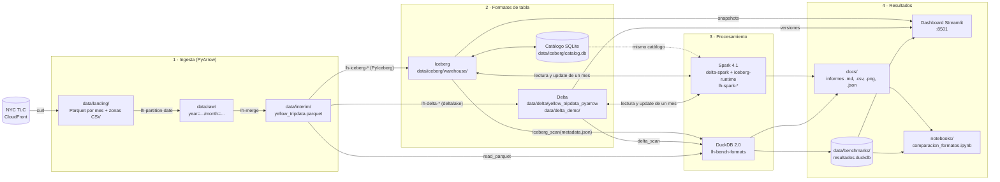
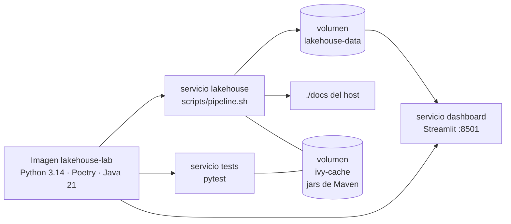

# Arquitectura

Recorrido de los datos, desde la descarga de NYC TLC hasta el dashboard y el notebook. Cada caja de proceso es un comando `lh-*` de `pyproject.toml`; `scripts/pipeline.sh` los ejecuta en este orden.

## Piezas

| Capa | Qué hace | Código |
|---|---|---|
| Ingesta | Descarga los tres meses de 2025, los particiona por fecha de recogida y los une en un Parquet consolidado, que es la línea base sin formato de tabla. | `scripts/pipeline.sh`, `src/lakehouse/ingest/` |
| Delta | Escribe la tabla con `deltalake` (sin Spark) y practica MERGE, *time travel*, evolución de esquema, OPTIMIZE y VACUUM sobre una copia (`delta_demo`). | `src/lakehouse/delta/` |
| Iceberg | Crea el catálogo SQLite, la tabla con *hidden partitioning*, un snapshot por mes, evolución de partición y rollback. | `src/lakehouse/iceberg/` |
| Spark | Lee y escribe las tres tablas, y reescribe febrero en Delta e Iceberg. Usa el mismo catálogo que PyIceberg. | `src/lakehouse/spark/` |
| Benchmark | Las mismas seis consultas con DuckDB sobre los tres formatos; guarda informes en `docs/benchmarks/` y cada ejecución en la base de resultados. | `src/lakehouse/benchmarks/` |
| Dashboard | Tres pestañas: benchmarks, snapshots y *time travel*, y guía de formatos. | `src/lakehouse/dashboard/` |
| Notebook | Comparación final con las mediciones guardadas y una medición en vivo. | `notebooks/comparacion_formatos.ipynb` |

## En Docker

`make demo` construye la imagen (Python 3.14, Poetry, Java 21) y ejecuta todo dentro de contenedores:

- **Los datos viven en un volumen**, no en el `data/` del host: el catálogo de Iceberg guarda rutas absolutas, que dentro del contenedor empiezan por `/app/data`.
- **Los informes sí se escriben en el `docs/` del repositorio**, para versionarlos.
- **Los jars de Spark** (Delta, Iceberg, SQLite JDBC) se descargan de Maven la primera vez y quedan en `ivy-cache`.
